<p align="center">
  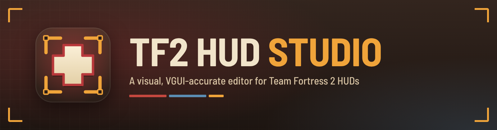
</p>

<p align="center">
  <a href="https://github.com/XeraFang-Solutions/TF2-HUD-Studio/releases/latest"></a>
  <a href="https://github.com/XeraFang-Solutions/TF2-HUD-Studio/releases/tag/cutting-edge"></a>
  <a href="https://github.com/XeraFang-Solutions/TF2-HUD-Studio/actions/workflows/ci.yml"></a>
  <a href="LICENSE"></a>
</p>

**TF2 HUD Studio** is a desktop editor for Team Fortress 2 HUDs. Open a HUD folder and you get a live, VGUI-accurate
preview of what the game will draw. You can drag elements around, edit properties, colors, fonts and animations, and
install the result into `tf/custom`, all without guessing what a `.res` value will do in game.

It is a portable app for Windows, Linux and macOS: download one file and run it, no installer.

<p align="center">
  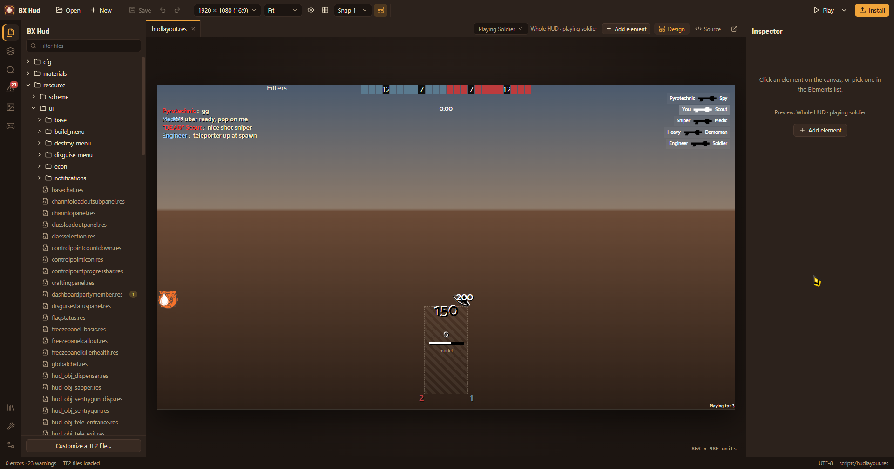
</p>

> [!NOTE]
> TF2 HUD Studio is a community project. It is not made by, affiliated with, or endorsed by Valve Corporation.
> Team Fortress 2 and the TF2 logo are trademarks of Valve. The HUD in the screenshots is *bxhud-sayo*.

---

## Contents

- [Download](#download)
- [Features](#features)
- [Getting started](#getting-started)
- [Using the studio](#using-the-studio)
- [How accurate is the preview?](#how-accurate-is-the-preview)
- [Keyboard shortcuts](#keyboard-shortcuts)
- [HUD library and TFHUD.manifest](#hud-library-and-tfhudmanifest)
- [Testing in TF2](#testing-in-tf2)
- [Text and image editors](#text-and-image-editors)
- [Where things are stored](#where-things-are-stored)
- [Building from source](#building-from-source)
- [Tests](#tests)
- [Project layout](#project-layout)
- [Versioning and releases](#versioning-and-releases)
- [Contributing, security and conduct](#contributing-security-and-conduct)
- [License](#license)

The [wiki](https://github.com/XeraFang-Solutions/TF2-HUD-Studio/wiki) has longer guides for each part of the app.

## Download

Grab the file for your system from the **[latest release](https://github.com/XeraFang-Solutions/TF2-HUD-Studio/releases/latest)**.
Every build is portable, so there is nothing to install. Put the file anywhere and run it.

| Platform | File | Requirements |
| --- | --- | --- |
| Windows 10/11 (x64) | `TF2-HUD-Studio-<version>-windows-x64.exe` | Microsoft Edge WebView2 (already part of Windows 11 and up-to-date Windows 10) |
| Linux (x86_64) | `TF2-HUD-Studio-<version>-linux-x86_64.AppImage` | A desktop with glibc 2.35 or newer (Ubuntu 22.04, Fedora 36, Steam Deck desktop mode, …). Run `chmod +x` on the file first. |
| macOS 11+ (Apple Silicon and Intel) | `TF2-HUD-Studio-<version>-macos-universal.zip` | Unzip it and move **TF2 HUD Studio.app** wherever you like. |

**The builds aren't code-signed yet**, so your OS will warn you the first time you run one:

- **Windows:** SmartScreen says "Windows protected your PC". Click **More info → Run anyway**.
- **macOS:** right-click the app, choose **Open**, then confirm. You can also run
  `xattr -dr com.apple.quarantine "TF2 HUD Studio.app"`.
- **Linux:** AppImages need FUSE 2 (`libfuse2`). If it's missing, run the file with `--appimage-extract-and-run`.

### Cutting edge

If you want new features before they're polished, the
**[cutting-edge release](https://github.com/XeraFang-Solutions/TF2-HUD-Studio/releases/tag/cutting-edge)** is rebuilt
from every push to `main`. Its version looks like `1.0.0-edge.g1a2b3c4`, where the last part is the commit it was built
from. It may be rough, so back up your HUD before you use it.

## Features

**Preview that matches the game**
- Real VGUI layout rules:
  - proportional units for any resolution and aspect ratio;
  - the `r` / `c` / `s` / `p` / `cs` / `rs` position prefixes and `f` / `p` / `o` sizes;
  - `pin_to_sibling` with both corners;
  - `#base` / `#include` inheritance;
  - duplicate-block merging;
  - `[$WIN32]`, `[$LINUX]`, `[$OSX]` and `if_match` conditions.
- Scheme colors, fonts (your HUD's own TTF/OTF files with real metrics), borders and VTF images. Images come from your HUD or straight out of TF2's VPKs.
- **Whole-HUD view:** `hudlayout.res` plus every element file, laid out the way the game composes them. A per-class "in game" scenario fills in health, ammo, the killfeed, chat, the team status bar and other runtime-only panels.
- Animation timeline for `hudanimations` scripts that plays on the canvas, with all the interpolators (Linear, Accel, Deaccel, Spline, Pulse, Flicker, Gain, Bias, Bounce).

**Editing**
- Drag, resize, multi-select, snap guides, arrow-key nudging and align tools. Edits keep each value's notation (`r10` stays `r10`) and write overrides when a value is inherited.
- The typed Inspector shows where each value comes from (this file, a `#base` file or TF2's defaults). It has color pickers and suggestions for fonts, colors, borders and siblings.
- Add, duplicate, rename and delete elements, starting from templates for the common VGUI controls.
- Scheme editor for colors, fonts and borders across all of a HUD's scheme files.
- Source editor with KeyValues highlighting, plus a one-click "Open in…" for **any text editor you like**.
- Image browser with previews of HUD and stock materials. **Edit images in your own image editor**; editors that can't read VTF get a PNG copy, which one click turns back into the VTF.
- **Import images**: PNG becomes a lossless VTF and `.vmt` with no extra tools. TGA, JPG, PSD and WebP work through ImageMagick, and compressed DXT5 through VTFCmd.
- Undo and redo across files. Save all, with automatic backups, external-change detection and UTF-16 files.

**Working on a HUD**
- The Problems panel lists syntax errors, broken `#base` chains, undefined colors and fonts, missing images and animation script errors. Click one to jump to it.
- Project-wide search, quick open (<kbd>Ctrl</kbd>+<kbd>P</kbd>) and an Elements tree.
- A new-HUD wizard, "customize a TF2 file" for overriding stock files, one-click install to `tf/custom`, and zip export.
- **HUD library**: keep your HUDs in one folder, see them with their icons, and swap which one TF2 loads in one click. A HUD can be installed as a **link** (a junction on Windows) instead of a copy, so nothing is duplicated and every save is live in game.
- **`TFHUD.manifest`**: each HUD's name, version, author, description, icon, banner and links, shown in the library.

**Testing in TF2**
- **Play** starts TF2: 64-bit (standard) or 32-bit (legacy) on Windows. It can load straight into `itemtest` as a local game (`sv_lan 1`, borderless window at your display size, quick-start switches).
- A **remote console** (`-usercon` on 127.0.0.1, with a new password every launch) and the game's **console log** (`-condebug`) appear right in HUD Studio.
- **Reload HUD** after every save, plus one-click **test commands**: change class or map, add bots, give yourself crits, Über or any Mannpower power-up, force a win, turn on tournament mode, show the VGUI panel tree, and more.
- Finds your TF2 install through Steam automatically.

### Screenshots

| Start screen | Source view |
| --- | --- |
| 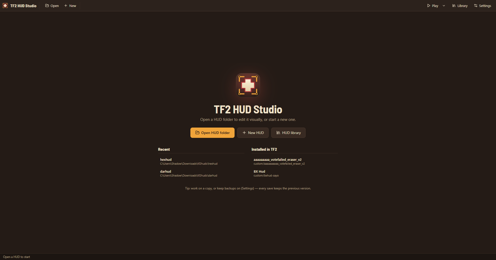 | 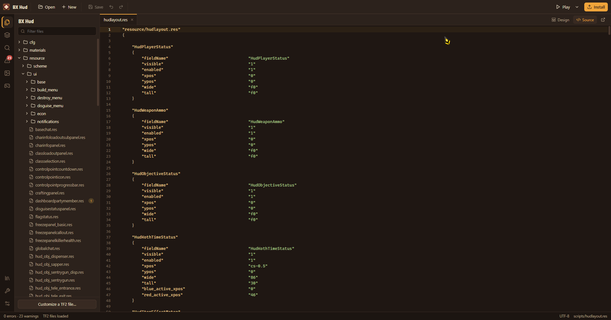 |

| Scheme editor | Animation timeline |
| --- | --- |
| 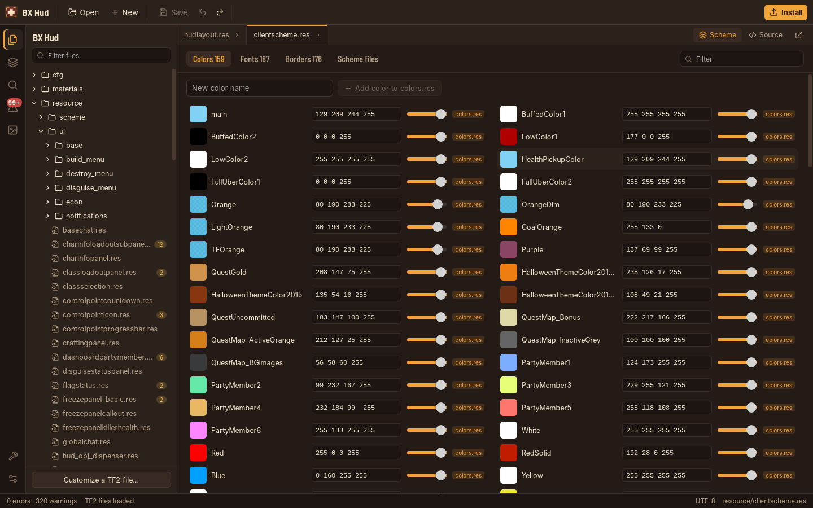 | 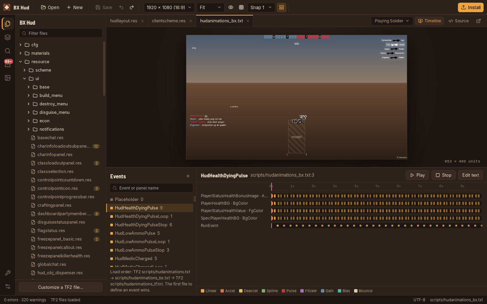 |

| Settings | External tools |
| --- | --- |
| 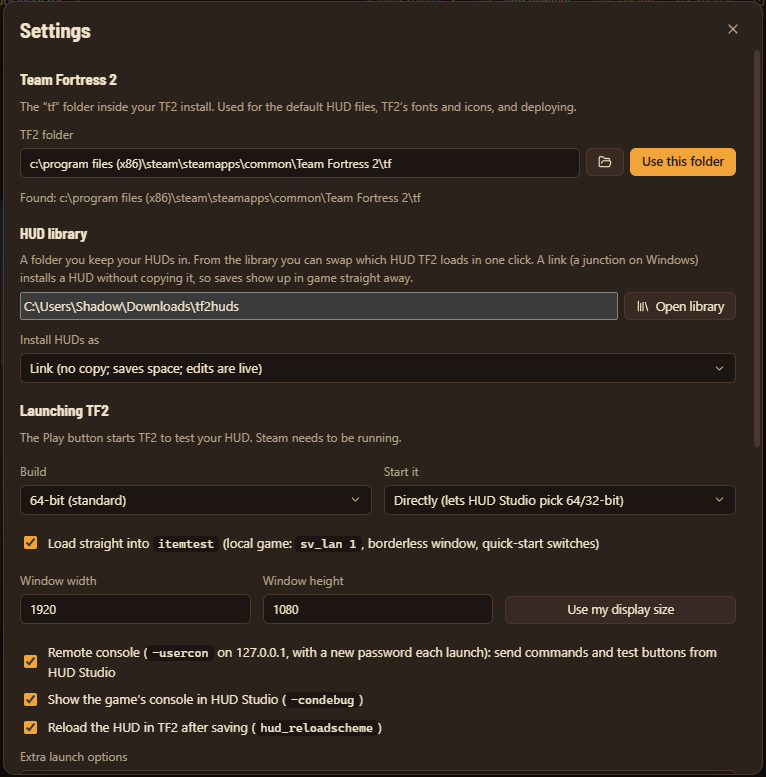 | 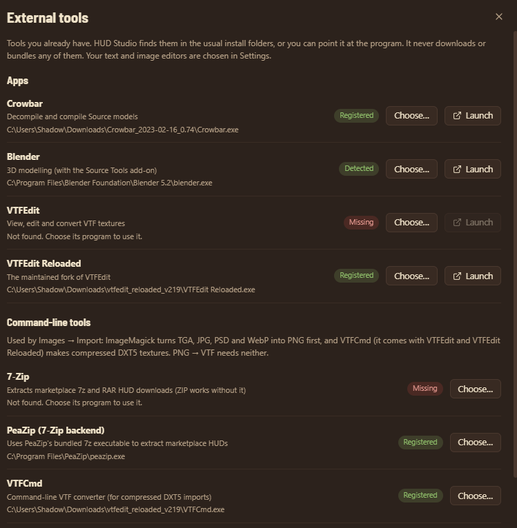 |

<p align="center">
  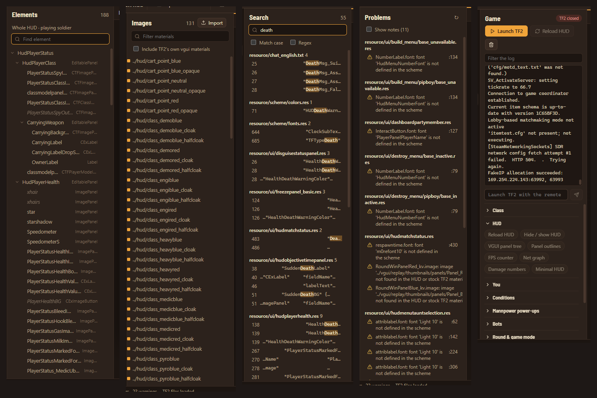
  <br><sub>Sidebar panels: Elements, Images, Search, Problems and the Game console with test commands</sub>
</p>

## Getting started

1. **Run the app.** On first launch it looks for TF2 through Steam. If it can't find the game, open **Settings** (the sliders icon, bottom left) and choose your `…/Team Fortress 2/tf` folder. With TF2 found, the preview can show stock fonts and icons and TF2's default HUD files.
2. **Open a HUD:** **Open** in the toolbar, then pick the HUD's folder (the one with `info.vdf` and `resource/` in it). You can also pass the folder on the command line: `TF2-HUD-Studio.exe "C:\…\tf\custom\myhud"`.
   Or click **New** to start a HUD from TF2's defaults or from an empty template.
3. **Open `scripts/hudlayout.res`** to see the whole HUD, or open any `.res` file to work on that panel on its own.
4. **Edit.** Click an element on the canvas or in the Elements tree, then drag it or change values in the Inspector.
5. **Save** with <kbd>Ctrl</kbd>+<kbd>S</kbd>. One designer edit can change several files, and they are all saved together.
6. **Install** (top right) copies the HUD into `tf/custom`. Then start TF2, or run `hud_reloadscheme` in the console if it's already running.

## Using the studio

- **Designer:** the canvas shows the active `.res` file at the resolution picked in the toolbar. Toggle the grid, snapping and *show hidden elements* there. Hold <kbd>Alt</kbd> while dragging to turn off snapping, and <kbd>Shift</kbd> while resizing to keep the aspect ratio.
- **Values TF2 already defines:** if you edit a value that comes from TF2's default HUD, the studio asks once, copies that file into your HUD, and writes the override there.
- **Pinned elements:** `xpos`/`ypos` on a pinned element point *outward* from the sibling's corner. So `-1 -1` on a top-left pin gives a down-right drop shadow, exactly as in game.
- **Duplicate keys:** within one block the first occurrence wins, like TF2's KeyValues reader. Duplicate *blocks* merge, with the later one overriding. The Problems panel flags both.
- **Conditions:** `[$WIN32]`-style conditions are evaluated for the platform chosen in Settings (Windows by default). `[$X360]` and other console conditions are always false.
- **Animations:** open any `hudanimations_*.txt` file, pick an event and press **Play**. The manifest's load order is shown, because the first file to define an event wins.

There is a guide to each panel in the [wiki](https://github.com/XeraFang-Solutions/TF2-HUD-Studio/wiki).

## How accurate is the preview?

The layout engine follows VGUI's rules and is tested against real HUDs (budhud, bxhud and TF2's own files). Some
things are only known while the game is running, so the preview fills them in with believable stand-ins:

- player names, health and ammo values, the killfeed, chat and scores come from the chosen scenario;
- elements the game shows or hides at runtime (for example the Medic charge meter) follow the class you pick;
- 3D model panels show a placeholder box;
- text is drawn with your HUD's fonts, but outlines, blur and drop shadows on fonts are approximations.

If something looks different in game, please open a
[render mismatch report](https://github.com/XeraFang-Solutions/TF2-HUD-Studio/issues/new?template=hud_render_mismatch.yml).
Those reports are the fastest way to make the preview better.

## Keyboard shortcuts

| Keys | Action |
| --- | --- |
| <kbd>Ctrl</kbd>+<kbd>S</kbd> | Save all edited files |
| <kbd>Ctrl</kbd>+<kbd>Z</kbd> / <kbd>Ctrl</kbd>+<kbd>Y</kbd> (or <kbd>Ctrl</kbd>+<kbd>Shift</kbd>+<kbd>Z</kbd>) | Undo / redo |
| <kbd>Ctrl</kbd>+<kbd>P</kbd> | Go to a file or element |
| <kbd>Ctrl</kbd>+<kbd>Shift</kbd>+<kbd>F</kbd> | Search the whole HUD |
| <kbd>Ctrl</kbd>+<kbd>Shift</kbd>+<kbd>E</kbd> | Open the current file in your text editor (at the cursor's line) |
| <kbd>Ctrl</kbd>+<kbd>D</kbd> | Duplicate selected elements |
| <kbd>Delete</kbd> | Delete selected elements |
| Arrow keys / <kbd>Shift</kbd>+arrows | Nudge by 1 / 10 units |
| <kbd>Ctrl</kbd>+<kbd>0</kbd> | Zoom to fit |
| <kbd>Esc</kbd> | Clear the selection |
| Middle-click a tab | Close it |
| Right-click a file, tab or problem | Open in your text or image editor, or show it in its folder |

On macOS, use <kbd>Cmd</kbd> instead of <kbd>Ctrl</kbd>.

## HUD library and TFHUD.manifest

Open **HUD library** (the books icon, bottom left) and choose a folder outside `tf/custom`, for example `Documents/TF2 HUDs`.
Every HUD in that folder appears as a card.

<p align="center">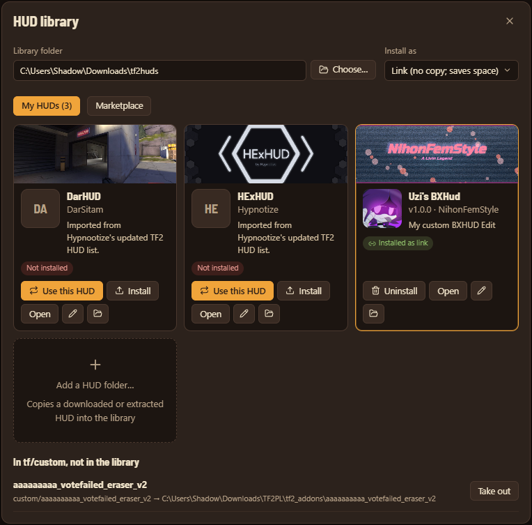 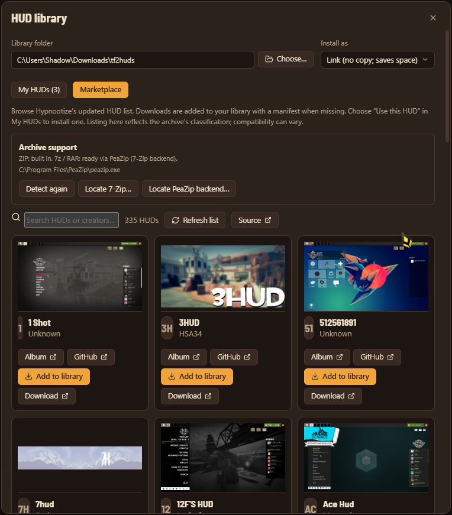</p>

The **Marketplace** tab loads [Hypnootize's Updated HUDs List](https://github.com/Hypnootize/TF2-HUDs-Archive/blob/master/Updated%20HUDs%20List.md). Search by HUD or creator, open screenshot albums and repositories, or **Add to library** to download and extract a HUD. Downloads do not change the active TF2 HUD: switch to **My HUDs** and choose **Use this HUD** when ready. A saved catalogue remains available if refreshing fails; downloads still need an internet connection. The list's “updated” status is maintained by the archive and is not a compatibility guarantee.

Marketplace cards automatically try to show the album's first image: GitHub showcase Markdown/HTML, embedded Imgur album images, or album image metadata. Previews load as cards come into view, with three lookups at a time, a 4 MiB image limit and a one-day disk cache (saved images remain usable offline). If an album requires JavaScript or blocks access, the card keeps its album link and shows a placeholder. A resolved preview also becomes the banner in a newly generated import manifest; existing manifests and banners are preserved.

ZIP extraction is built in. For **7z and RAR**, HUD Studio detects **7-Zip** or **PeaZip's bundled 7-Zip backend** in PATH and common Windows installation folders. You can also locate `7z.exe`, `7zz`, or `7z` manually and **Detect again** after installing. If none is found, the marketplace links to the official [7-Zip](https://www.7-zip.org/) (recommended) and [PeaZip](https://peazip.github.io/) sites. PeaZip's executable is usually `PeaZip/res/bin/7z/7z.exe`; choose that backend rather than the graphical app. HUD Studio never installs these tools automatically.

Imported HUDs without a `TFHUD.manifest` receive one with their catalogue name, creator, repository, homepage and source links (including album/download provenance). Existing manifests are preserved. Imports use a staging folder and never overwrite an existing library HUD. Unsupported archives or download landing pages can still be opened with **Download** and imported manually after extraction. Automatic imports accept ZIP, 7z and RAR, with limits of 256 MiB downloaded, 1 GiB extracted and 30,000 entries; archives with links, unsafe paths or encryption are rejected.

- **Use this HUD** installs it and takes the other HUDs out of `tf/custom`. Configs, hitsounds and other non-HUD content are left alone.
- **Install as link** (the default) makes `tf/custom/<name>` a junction (Windows) or symlink (Linux and macOS) to the library folder. Nothing is copied, and HUD Studio's saves are what TF2 loads. **Install as copy** makes a snapshot instead.
- Removing an install never deletes a HUD: links are just removed, and real folders are moved to HUD Studio's backups.
- HUDs already in `tf/custom` can be **moved to the library** (and linked back) in one click, and downloaded HUDs can be **added** from any folder.

Each HUD can carry a `TFHUD.manifest` at its root: a KeyValues file like `info.vdf` that TF2 ignores.

```
"TFHUD"
{
	"manifest_version"	"1"
	"name"			"My HUD"
	"version"		"1.2.0"
	"author"		"me"
	"description"	"A short description."
	"icon"			"tfhud/icon.png"
	"banner"		"tfhud/banner.png"
	"homepage"		"https://…"
	"source"		"https://github.com/…"
	"license"		"…"
	"tags"			"minimal, competitive"
}
```

Edit it with **HUD details** (on a library card, or in the Install dialog). Images you pick are copied into the HUD's
`tfhud/` folder. Saving edits the file in place, so your own comments and extra keys survive. New HUDs get a manifest automatically.

## Testing in TF2

The **Play** button (top right) starts TF2. Its menu chooses the 64-bit or 32-bit (legacy) build on Windows. On Linux, TF2 is 64-bit
only and starts through Steam. TF2 no longer runs on macOS. Steam needs to be running.

With **Start in itemtest** on, TF2 is started with:

```
-window -noborder -w <width> -h <height> -noipx -nosteamcontroller -softparticlesdefaultoff -nohltv -nojoy -enablefakeip
+sv_lan 1 +map itemtest
```

The window size is detected from your display the first time you launch; change it in **Settings → Launching TF2**.

With **Remote console** on, HUD Studio adds `-usercon -port <free port> +ip 127.0.0.1 +rcon_password <random> +net_start`. The password is new
for every launch and the console only listens on your own machine. The **Game** panel (the gamepad icon) shows the game's console
(`-condebug`), takes console commands, reloads the HUD after each save, and has buttons for:

- the **HUD**: reload it, hide it, the VGUI panel tree, panel outlines, the FPS counter, damage numbers and minimal HUD;
- **you**: class, team, respawn, damage, overheal, god mode, third person and spectating;
- **conditions** such as crits, Über, Buff Banner, Jarate, Mad Milk, bleeding and cloak, and every **Mannpower power-up**;
- **bots**: add puppet bots on either team, have them copy you or fire, and kick them;
- the **round**: skip waiting for players, restart, force a win and tournament mode;
- **maps**: itemtest, 2Fort, Badlands, Harvest, Badwater, Hightower, Coal Town (MvM), Foundry (Mannpower) and Walkway.

Buttons marked with a red dot turn on `sv_cheats`, so they only work in a local game such as itemtest. Your own launch options go in
**Settings → Launching TF2 → Extra launch options**.

## Text and image editors

The built-in source editor is always there, but you can also send files to your own editors. Choose them under
**Settings → Text editor** and **Settings → Image editor**:

- **System default app**: whatever your OS opens the file with.
- **Found on this computer**: editors the studio detected on your PATH, in the usual install folders, or in `/Applications`.
- **Other known apps**: about 45 text editors and 25 image editors the studio knows how to launch. These include:
  - text: VS Code, VSCodium, Cursor, Zed, Sublime Text, Notepad++, Kate, JetBrains IDEs, Vim, Neovim, Emacs, Helix and more;
  - images: GIMP, Photoshop, Krita, Paint.NET, Affinity Photo, Pixelmator, Aseprite, VTFEdit and more.

  Pick one that wasn't found and you're asked where its program is.
- **Custom program…**: any program. For text editors, you can give an argument template, where `{file}` and `{line}` are filled in,
  e.g. `-g "{file}:{line}"`.

Text editors that support it open at the right line. Terminal editors such as Vim or Helix open in a new terminal window.
For a `.vtf`, **Edit a PNG copy** decodes it to a PNG that any image editor can open. When you're done,
**Save PNG copy into HUD** writes it back as a VTF. For a TF2 texture, it's saved as an override in your HUD.

**Images → Import** turns a picture into `materials/vgui/<name>.vtf` plus a matching `.vmt`, ready to use as an `image`:

- PNG works out of the box (lossless BGRA8888, no mipmaps).
- TGA, JPG, PSD, WebP and other formats need [ImageMagick](https://imagemagick.org).
- "Compress (DXT5)" needs VTFCmd, which comes with VTFEdit and VTFEdit Reloaded.

The **Tools** panel (the wrench icon, bottom left) finds and launches **Crowbar**, **Blender**, **VTFEdit** and **VTFEdit Reloaded**. It
also locates the command-line converters **VTFCmd** and **ImageMagick**, or lets you point it at them.

## Where things are stored

The app itself is a single portable file, but your settings live in your user profile, so they survive updates:

| | Windows | Linux | macOS |
| --- | --- | --- | --- |
| Settings | `%APPDATA%\solutions.xerafang.tf2hudstudio\` | `~/.config/solutions.xerafang.tf2hudstudio/` | `~/Library/Application Support/solutions.xerafang.tf2hudstudio/` |
| Backups | `%APPDATA%\solutions.xerafang.tf2hudstudio\backups\` | `~/.local/share/solutions.xerafang.tf2hudstudio/backups/` | `~/Library/Application Support/solutions.xerafang.tf2hudstudio/backups/` |

Each save makes a backup folder, and the newest 60 per HUD are kept. You can turn backups off in Settings, and
**Settings** shows the exact path on your machine.

## Building from source

You'll need:
- [Rust](https://rustup.rs) (stable);
- [Node.js](https://nodejs.org) 20 or newer;
- the [Tauri 2 system packages](https://v2.tauri.app/start/prerequisites/) for your OS. On Debian/Ubuntu:
  `sudo apt install libwebkit2gtk-4.1-dev libappindicator3-dev librsvg2-dev patchelf`.

```bash
git clone https://github.com/XeraFang-Solutions/TF2-HUD-Studio.git
cd TF2-HUD-Studio
npm ci --prefix apps/desktop

npm run tauri:dev                  # run with hot reload
npm run tauri:build                # optimized build (AppImage on Linux, .app on macOS)
npm run tauri -- build --no-bundle # just the portable executable (what Windows releases use)
```

The built app ends up in `target/release/` (and `target/release/bundle/` for bundles). You can pass a HUD folder on the
command line to open it at startup.

## Tests

```bash
npm test                     # everything: cargo test --workspace + the frontend tests
cargo test --workspace       # parser, core library and backend
npm --prefix apps/desktop test   # layout and animation engine (node --test)

# Lossless round trip and full resolution against a real HUD:
HUD_CORPUS_PATH=/path/to/some/hud cargo test -p hud-syntax --test solar_light_corpus
HUD_CORPUS_PATH=/path/to/some/hud cargo test -p hud-core --test real_hud

# VPK and stock-file paths against a TF2 install:
FAKE_TF_DIR=/path/to/tf cargo test -p hud-core --test fake_game
```

CI runs the following on Windows, Linux and macOS for every push and pull request:
- `cargo fmt --check`;
- `cargo clippy -D warnings`;
- every Rust test, the frontend build and the frontend tests;
- the corpus tests against budhud.

## Project layout

```
crates/
  hud-syntax/     Lossless KeyValues parser: tokens, tree, diagnostics and minimal text edits
  hud-core/       HUD model: virtual file system (HUD + TF2 + VPKs), #base resolution,
                  schemes, animations, VTF decoding, fonts, lint, project setup and installing
apps/desktop/
  src/            React + TypeScript UI: canvas, VGUI layout engine, inspector, editors
  src-tauri/      Tauri 2 backend: commands, sessions, settings, external editors
fixtures/         Small synthetic HUDs used by the tests
scripts/          set-version.mjs (VERSION → package.json, Cargo.toml, tauri.conf.json)
artwork/          Logo, banner, social preview and screenshots
docs/             Architecture and maintainer docs
wiki/             Source for the GitHub wiki (published by .github/workflows/wiki.yml)
```

[`docs/ARCHITECTURE.md`](docs/ARCHITECTURE.md) explains how the pieces fit together.

## Versioning and releases

The version lives in a single file, **[`VERSION`](VERSION)**, and follows [Semantic Versioning](https://semver.org).

| Workflow | Runs on | Produces |
| --- | --- | --- |
| [`ci.yml`](.github/workflows/ci.yml) | every push and pull request | fmt, clippy, tests and builds on Windows, Linux and macOS |
| [`release.yml`](.github/workflows/release.yml) | a push to `main` that **changes `VERSION`** | tag `v<VERSION>` and a GitHub release with the three portable builds |
| [`cutting-edge.yml`](.github/workflows/cutting-edge.yml) | every push to `main` (except docs-only changes) | the rolling `cutting-edge` pre-release, versioned `<VERSION>-edge.g<commit>` |
| [`wiki.yml`](.github/workflows/wiki.yml) | changes under `wiki/` | publishes the GitHub wiki |

To cut a release, bump `VERSION`, run `npm run version:sync` and merge to `main`. The details are in
[`docs/RELEASING.md`](docs/RELEASING.md).

## Contributing, security and conduct

Contributions are welcome. Please see:
- [CONTRIBUTING.md](CONTRIBUTING.md) for setup, code style and how to send a pull request;
- [SECURITY.md](SECURITY.md) for how to report a vulnerability privately;
- [CODE_OF_CONDUCT.md](CODE_OF_CONDUCT.md) for how we treat each other.

Bug reports and ideas go to the [issue tracker](https://github.com/XeraFang-Solutions/TF2-HUD-Studio/issues/new/choose).

## License

TF2 HUD Studio is free software under the [GNU General Public License v2.0](LICENSE) (GPL-2.0-only).
Copyright © 2026 XeraFang Solutions.

HUDs you make with TF2 HUD Studio are yours. The license covers the editor, not your work.
